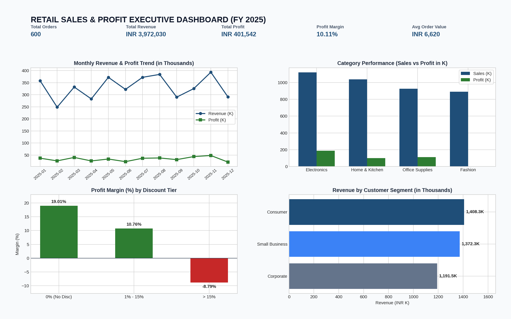

# Retail Sales & Profit Performance Analysis

An end-to-end **Data Analyst** portfolio project analyzing 600 retail e-commerce orders (FY 2025) using **Python (Pandas, Matplotlib)**, **SQL (SQLite)**, and an **Interactive Excel Dashboard (`.xlsx`)** to uncover revenue trends, category profitability, customer segment behavior, regional performance, and the financial impact of discounting.

## Project Objectives
* Clean a raw transactional dataset containing duplicate orders, missing values, whitespace noise, and mixed date formats.
* Answer 9 core business KPI questions using structured SQL queries (monthly, quarterly, weekday vs. weekend, category, region, segment, and discount tiers).
* Build both a **4-panel Executive Dashboard PNG** for quick GitHub viewing and a **formula-driven Excel Dashboard (`.xlsx`)** with native charts.
* Translate raw metrics into actionable pricing and inventory recommendations.

## Repository Structure
```text
retail-sales-analysis/
├── data/
│   ├── raw_retail_sales.csv            # Raw dataset (615 rows with duplicates & nulls)
│   └── cleaned_retail_sales.csv        # Cleaned dataset (600 unique orders)
├── sql/
│   └── sql_queries.sql                 # 9 business KPI & profitability SQL queries
├── scripts/
│   └── cleaning_and_eda.py             # End-to-end cleaning, SQLite execution & charts
├── dashboard/
│   └── retail_sales_dashboard.xlsx     # Interactive Excel dashboard (formulas + charts)
├── charts/
│   ├── executive_dashboard.png         # 4-panel Executive Summary Dashboard
│   ├── monthly_revenue_trend.png
│   ├── category_sales_vs_profit.png
│   └── region_performance.png
└── README.md
```

## Executive Dashboard Preview


## Tools & Technologies
* **Python:** `pandas`, `sqlite3`, `matplotlib`
* **SQL:** Aggregations, `CASE` tiering, `GROUP BY`, date slicing (`strftime`), profit margin & AOV calculations
* **Excel:** Dynamic cross-sheet formulas (`SUM`, `SUMIF`, `COUNTIF`, `COUNTA`), KPI cards, and native charts

## Key Business Metrics (FY 2025)
| Metric | Value |
| :--- | ---: |
| **Total Unique Orders** | 600 |
| **Total Units Sold** | 2,132 |
| **Total Revenue** | ₹3,972,030.00 |
| **Total Profit** | ₹401,541.50 |
| **Overall Profit Margin** | 10.11% |
| **Average Order Value (AOV)** | ₹6,620.05 |

## Key Insights & Findings
1. **Electronics Drives Profitability:** Electronics generated the highest revenue (**₹1,119,155.00**) and profit (**₹187,915.00**) with a **16.79%** profit margin, led by *Mechanical Keyboard* (**₹70,035.00** profit) and *Smart Watch* (**₹42,880.00** profit).
2. **Fashion Margin Erosion:** Despite generating **₹889,165.00** in sales (153 orders), the Fashion category delivered only **₹342.00** in total profit (**0.04%** margin) due to heavy discounting.
3. **Discounts Above 15% Cause Net Losses:** Orders with **>15% discount** (145 orders) brought in ₹715,245.00 in sales but resulted in a **-₹62,905.00 net loss (-8.79% margin)**. In contrast, 0% discount orders achieved a **19.01%** margin and 1%–15% discount orders maintained a **10.76%** margin.
4. **Customer Segment & Weekend Behavior:** **Consumer** led total revenue (**₹1,408,312.50**; 210 orders), while **Small Business** had the highest segment AOV (**₹7,037.24**). Weekend orders had a higher AOV (**₹7,085.22**) than weekday orders (**₹6,466.37**).
5. **Seasonal & Regional Patterns:** Q3 led revenue (**₹1,046,592.50**) while Q4 led profit (**₹112,272.50**, **11.12%** margin), peaking in November (**₹393,355.00** revenue). North led total sales (**₹1,050,252.50**), while South recorded the highest regional AOV (**₹6,881.02**).

## Business Recommendations
* **Cap Discounts at 15%:** Eliminate blanket >15% discounts—especially in Fashion—and replace them with bundle offers or minimum-order thresholds.
* **Expand High-Margin Electronics & Office Supplies:** Prioritize ad spend and inventory for *Mechanical Keyboards*, *Ergonomic Chairs*, and *Smart Watches*.
* **Target High-AOV Segments & Weekends:** Run upsell campaigns for Small Business buyers and weekend shoppers where basket sizes are largest.

## How to Run Locally
```bash
pip install pandas matplotlib
python scripts/cleaning_and_eda.py
```
